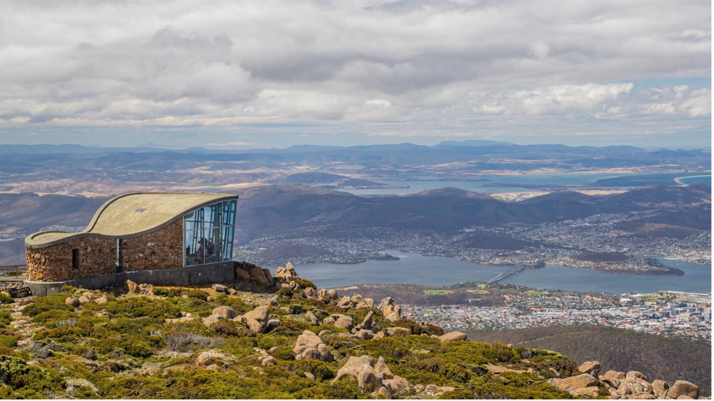
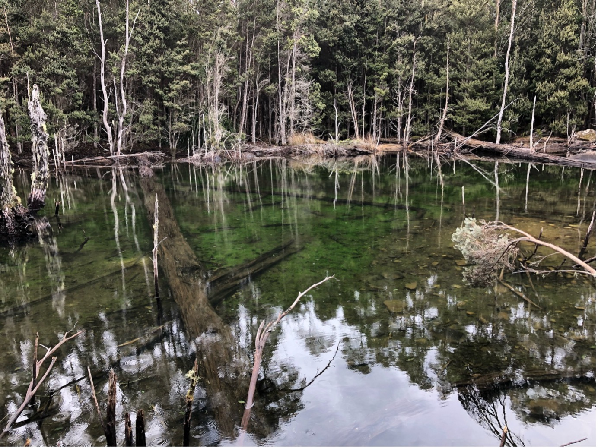
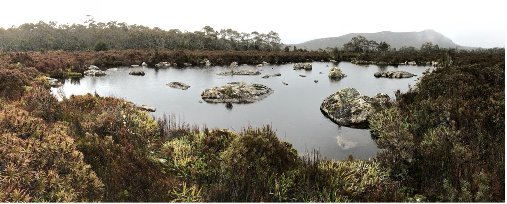
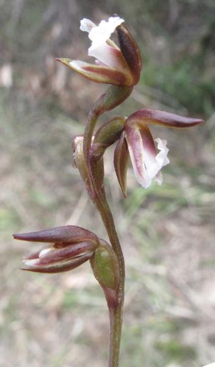
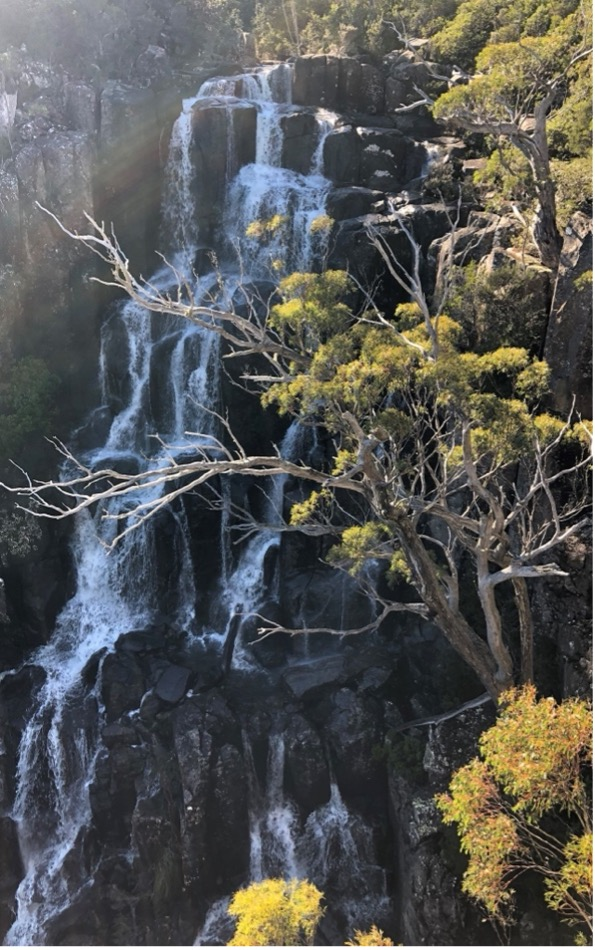
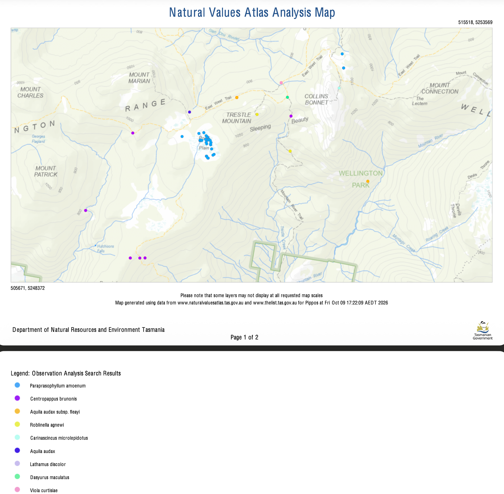
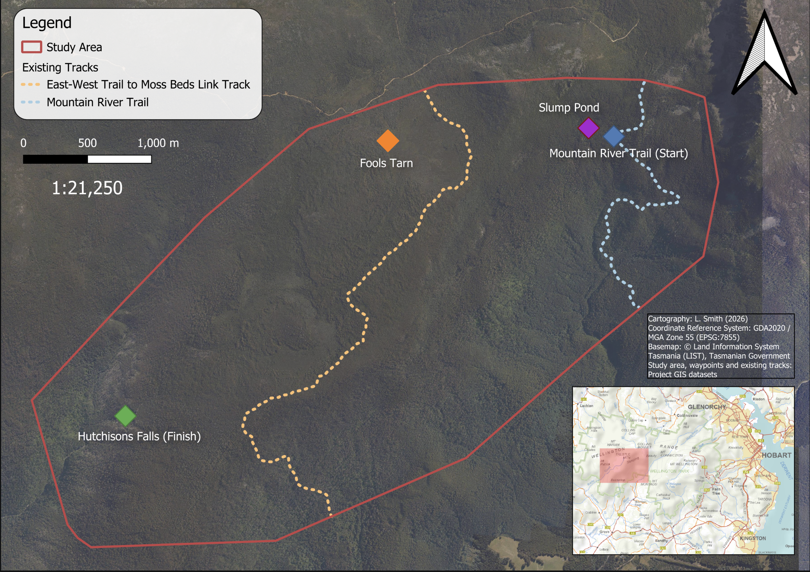

# Exploring Wellington Park

## The Location

Rising above nipaluna / Hobart in southern Tasmania, Wellington Park is a landscape of striking contrasts. Covering approximately 18,000 hectares, the Park extends westward from the 1,271-metre summit of kunanyi / Mount Wellington across rugged terrain characterised by dolerite cliffs, boulder fields, sheltered forests and open highland vegetation (Wellington Park Management Trust, 2013).

Its distinctive topography reflects a complex geological history. Jurassic dolerite formations, steep escarpments and landforms influenced by past periglacial processes contribute to considerable variation in elevation and slope. Environmental conditions also vary with altitude, exposure and drainage, supporting vegetation communities ranging from eucalypt forests to subalpine heathlands and highland sedgelands (Wellington Park Management Trust, 2013).

Beyond its ecological and geological significance, Wellington Park contains important water catchments and holds continuing cultural significance for Tasmanian Aboriginal people. Established under the Wellington Park Act 1993, the Park is managed to conserve these values while providing appropriate recreational opportunities (Wellington Park Management Trust, 2013).

This diversity provides a compelling setting for investigating walking-track suitability, where environmental conditions and terrain characteristics can change substantially across relatively short distances.

Figure 1. Wellington Park and its surrounding mountain landscape. Photograph: [Taken by Katische Haberfield].

## Geosites of Interest

Hidden within Wellington Park are geological features shaped by past climatic processes and the movement of rock and water. This project proposes a new walking track connecting three such destinations: Slump Pond, Fools Tarn and Hutchinsons Falls.

Each reveals a different aspect of the Park's geological and ecological character, while introducing distinct considerations for potential track development.

### Slump Pond

Slump Pond is a shallow depression approximately 100 metres long and 0.5 metres deep, formed through periglacial processes. Freeze–thaw activity transported dolerite boulders, while the removal of finer material contributed to a depression where water accumulated behind a natural boulder barrier (Geosite survey, 2019).

Figure 2. Slump Pond, a periglacial landform within Wellington Park. Photograph: [Taken by Mark Williams].

A drainage channel to the southwest may convey water during heavy rainfall, linking the landform to its surrounding hydrological system (Geosite survey, 2019).

The pond is situated within Eucalyptus tasmaniensis dry forest and woodland (TASVEG code DDE), as identified through the project's vegetation mapping (Department of Natural Resources and Environment Tasmania [NRE Tas], 2025). The project's species assessment records the silky snail or silky pinwheel snail within this community, highlighting the ecological importance of leaf litter, ground-layer vegetation and forest-floor habitat.

These characteristics introduce considerations for track placement, particularly where vegetation clearance, soil compaction or changes to drainage could disturb the surrounding environment. Recreational trail research demonstrates that infrastructure development and repeated use can alter vegetation and soil conditions (Ballantyne & Pickering, 2015).

### Fools Tarn

Fools Tarn reveals another dimension of Wellington Park's geological history. Periglacially transported dolerite boulders may restrict drainage and encourage water accumulation, while wind-driven sediment removal may have contributed to the formation of a deflation hollow (Geosite survey, 2019).

Figure 3. Fools Tarn and the surrounding highland environment. Photograph: [Taken by Mark Williams].

Unlike Slump Pond's forested surroundings, Fools Tarn is situated within highland grassy sedgeland (TASVEG code MGH). The 2019 geosite survey describes the area more broadly as buttongrass moorland, recording wet, loose and organically rich soils (Geosite survey, 2019; NRE Tas, 2025).

The project's species assessment records the Dainty leek-orchid within this vegetation community, introducing conservation considerations for the protection of native ground-layer vegetation and associated soils.

Figure 4. Prasophyllum amoenum or Dainty leek-orchid. Photograph: [Taken by Natural Resource Managment Tasmania].

The combination of sensitive ground flora, wet organic soils and localised drainage makes Fools Tarn particularly important when considering potential environmental disturbance. Research indicates that recreational trampling can contribute to vegetation damage, soil compaction and erosion (Pickering et al., 2010), highlighting the importance of careful track placement around the tarn.

### Hutchinsons Falls

The final destination, Hutchinsons Falls, is a waterfall system descending through a series of drops totalling more than 80 metres. Its surrounding landscape contains steep slopes, rocky gullies, cliffs and watercourses, illustrating the interaction between topography and flowing water (Hutchinsons Falls site description, n.d.).

Figure 4. Hutchinsons Falls and the surrounding steep, forested terrain. Photograph: [insert photographer or image source].

The project's TASVEG mapping identifies Eucalyptus tasmaniensis forest with broad-leaf shrubs (WDB) at Hutchinsons Falls. This vegetation community supports a eucalypt canopy and broad-leaf shrub understorey, within which the project's species assessment records the Tasmanian daisytree (NRE Tas, 2025).

Steep terrain and watercourses create physical challenges for the proposed track, while vegetation clearance and disturbance to drainage systems could affect the surrounding environment. Research into recreational trail impacts demonstrates the importance of considering soil and vegetation responses when locating new infrastructure (Ballantyne & Pickering, 2015).

### Connecting the Landscape

Beyond the three destinations, the study area includes Eucalyptus coccifera forest and woodland (DCO). The project's ecological assessment records the spotted-tailed quoll and wedge-tailed eagle within this community, highlighting conservation considerations across the wider route corridor.

The intervening landscape therefore encompasses contrasting vegetation, terrain and hydrological conditions. These variations demonstrate why a direct connection between destinations may not necessarily represent the most environmentally appropriate or physically practical alignment.

## Environmental and Terrain Considerations

Four geographical considerations underpin the evaluation of potential walking-track corridors: environmental sensitivity, slope, proximity to existing tracks and hydrological sensitivity.

### Environmental sensitivity

The study area's vegetation communities differ in ecological characteristics and susceptibility to disturbance. Conservation-significant species records introduce additional considerations for protecting native habitats. Recreational trail construction and use can contribute to vegetation loss, soil compaction and changes in plant community composition (Ballantyne & Pickering, 2015). Environmental sensitivity is therefore an important consideration in limiting potential ecological impacts from new infrastructure.

<strong>Figure 5.</strong> Vegetation suitability across the Wellington Park study area, showing the project-defined classification of TASVEG vegetation communities into five suitability categories.

### Slope and topography

Wellington Park's variable terrain influences both walking effort and the practicality of track development. Steeper gradients can increase physical demands, while gentler alignments may require longer routes. Walking speed also varies with gradient and direction of movement (Tobler, 1993), making slope relevant to both general corridor suitability and directional movement costs.

### Existing-track connectivity

The relationship between proposed and established walking tracks influences recreational accessibility and the amount of new infrastructure required. Connecting suitable sections of an existing network may reduce unnecessary ground disturbance and create more coherent recreational routes. Given the documented impacts of track infrastructure on soils and vegetation, limiting avoidable new track construction is an important planning consideration (Ballantyne & Pickering, 2015).

### Hydrological sensitivity

Watercourses and drainage systems contribute to Wellington Park's ecological and geomorphological processes, while water catchment protection is a recognised management priority (Wellington Park Management Trust, 2013). Track construction can alter local drainage, increase erosion and contribute to sediment movement, particularly where infrastructure intersects concentrated surface runoff (Pickering et al., 2010).

Together, these considerations illustrate the need to balance environmental protection, accessibility and walking convenience. Because an alignment may perform favourably against one characteristic but poorly against another, the project evaluates them collectively using spatial suitability modelling.

### Study Area and Proposed Walking-Track Network

The study area encompasses a section of Wellington Park, southern Tasmania, extending between the Mountain River Trail and three proposed walking destinations: Slump Pond, Fools Tarn and Hutchinsons Falls.

The spatial extent of the study area and the locations of these destinations are presented in Figure 4. The map establishes the geographical context for evaluating potential walking-track alignments across the landscape, connecting the selected destinations while accounting for terrain characteristics, environmental sensitivity and proximity to existing recreational infrastructure.

<strong>Figure 4.</strong> Study area and proposed walking-track destinations within Wellington Park, Tasmania. The map illustrates the study area boundary and the locations of Mountain River Trail, Slump Pond, Fools Tarn and Hutchinsons Falls.

