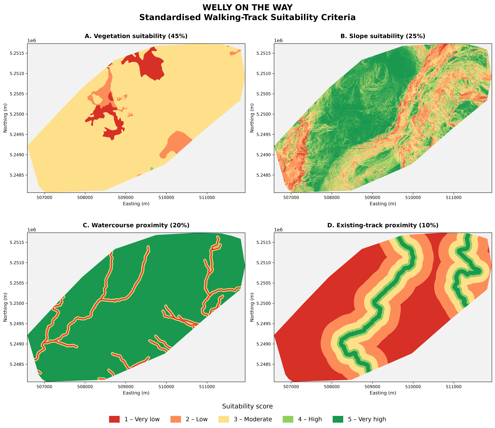
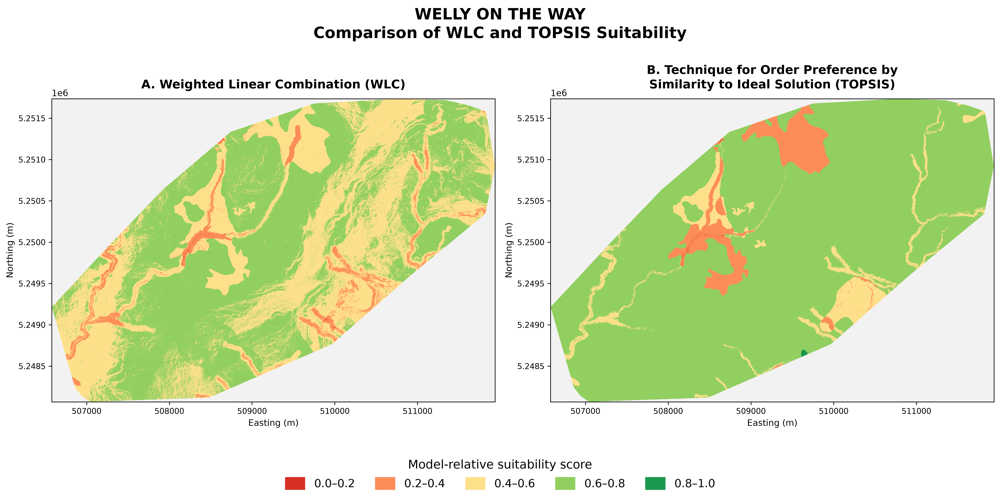
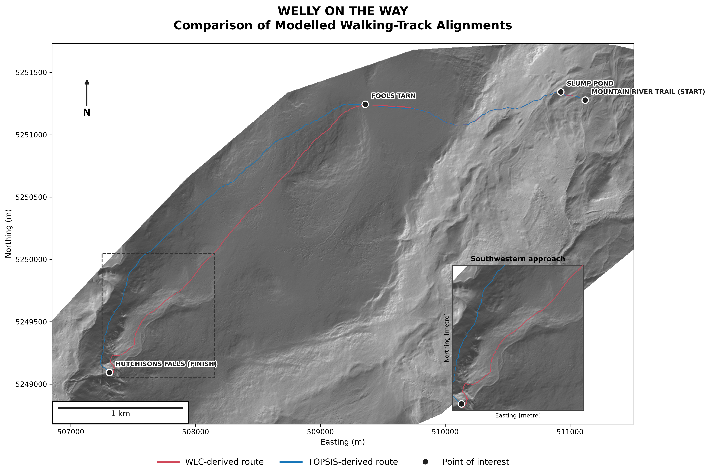

# Results

The spatial suitability modelling and least-cost path analysis produced two alternative walking-track networks connecting Mountain River Trail, Slump Pond, Fools Tarn and Hutchinsons Falls. Results are presented through the standardised criteria maps, WLC and TOPSIS suitability surfaces, and the resulting route alignments and walking-cost estimates.

## Standardised Criteria Suitability

The four standardised criteria surfaces are presented in **Figure 8**. Each raster was classified using a common suitability scale from 1 (very low suitability) to 5 (very high suitability), allowing spatial comparison between vegetation sensitivity, slope, watercourse proximity and existing-track proximity.

Vegetation sensitivity received the greatest weighting (45%), followed by slope (25%), watercourse proximity (20%) and existing-track proximity (10%). These weighted criteria formed the inputs to both MCDA models.

**Figure 8.** Standardised walking-track suitability criteria across the Wellington Park study area: vegetation sensitivity (45%), slope (25%), watercourse proximity (20%) and existing-track proximity (10%). Higher scores indicate greater suitability.

## Comparison of WLC and TOPSIS Suitability

The WLC and TOPSIS models generated spatial suitability surfaces using the same four criteria and weights but different decision rules (**Figure 9**). WLC scores ranged from 1.25 to 4.15, whereas TOPSIS relative-closeness scores ranged from 0.069 to 0.900.

For visualisation, WLC scores were linearly rescaled from the theoretical 1–5 range to 0–1, allowing both surfaces to be displayed using consistent colour classes. These scores remain model-relative and are not directly equivalent measures of suitability.

**Figure 9.** Comparison of (A) Weighted Linear Combination (WLC) and (B) Technique for Order Preference by Similarity to Ideal Solution (TOPSIS) suitability surfaces. Both are displayed on a 0–1 scale for visual comparison.

## Optimised Walking-Track Alignments

Dijkstra's least-cost path algorithm generated three connected route sections between the selected destinations. The WLC- and TOPSIS-derived alignments followed broadly similar trajectories, with localised differences in route placement (**Figure 10**).

The proposed alignments are displayed over a DEM-derived hillshade, with the destinations identified as points of interest.

**Figure 10.** Comparison of modelled walking-track alignments derived from WLC and TOPSIS suitability surfaces, displayed over DEM-derived hillshade. Labelled points of interest identify the destinations connected by the proposed routes.

## Route Distance, Walking Time and Penalised Cost

Table 1 compares route distance, estimated walking time and accumulated penalised cost for each section. The WLC network totalled 5,400.11 m, compared with 5,439.20 m for TOPSIS, a difference of 39.09 m (0.72%).

Despite this difference in distance, estimated walking times were nearly identical: 80.16 minutes for WLC and 80.04 minutes for TOPSIS. The longest section, Fools Tarn to Hutchinsons Falls, accounted for approximately 63% of the total distance in both models.

**Table 1.** Comparison of walking-track routes optimised using Dijkstra's algorithm with WLC and TOPSIS suitability models.

| Track section | Model | Distance (m) | Walking time (min) | Penalised cost (min-equivalent) |
|:---|:---|---:|---:|---:|
| Mountain River Trail → Slump Pond | WLC | 228.31 | 4.03 | 7.21 |
| | TOPSIS | 228.65 | 3.99 | 6.73 |
| Slump Pond → Fools Tarn | WLC | 1,762.37 | 30.59 | 57.31 |
| | TOPSIS | 1,759.30 | 30.55 | 55.55 |
| Fools Tarn → Hutchinsons Falls | WLC | 3,409.43 | 45.54 | 81.93 |
| | TOPSIS | 3,451.26 | 45.50 | 76.57 |
| **Total** | **WLC** | **5,400.11** | **80.16** | **146.44** |
| **Total** | **TOPSIS** | **5,439.20** | **80.04** | **138.84** |

*Note.* Routes were generated using Dijkstra's least-cost path algorithm, incorporating Tobler's anisotropic walking-cost function and a suitability penalty strength (λ) of 2.0. Walking times exclude suitability penalties, while accumulated penalised costs incorporate walking effort and model-specific suitability penalties. As the penalty surfaces are derived from different MCDA decision rules, penalised costs should not be interpreted as directly equivalent measures of environmental suitability.

The results indicate that the choice of MCDA method had a relatively small effect on total route distance and estimated walking time. Differences in spatial alignment and model-specific accumulated costs provide a basis for evaluating the implications of the two decision rules in the discussion.
